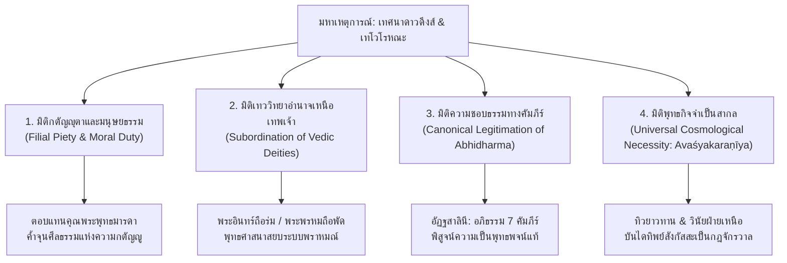

# บทที่ 6: การสังเคราะห์เปรียบเทียบทางวิวัฒนาการและประวัติศาสตร์นิพนธ์สากล: การสืบค้นแหล่งกำเนิดที่เก่าที่สุดรายประเด็น และข้อสรุปทางเทววิทยา

---

## 6.1 ตารางวิวัฒนาการเปรียบเทียบลำดับชั้นตัวบท (Textual Stratigraphy Matrix) 5 ยุคสมัย

---

### บทนำ: การจัดระเบียบลำดับชั้นตัวบททางภัทรวิทยา (Philological Stratigraphy)

การศึกษาวิเคราะห์ตัวบทเปรียบเทียบข้ามสายจารีต ทั้งภาษาบาลี สันสกฤต จีน ปรากฤต และฝรั่งเศส ตลอดจนหลักฐานทางโบราณคดีและจารึกวิทยาที่ได้ดำเนินการมาตั้งแต่บทที่ 1 ถึงบทที่ 5 นำมาสู่บทสรุปอันเป็นหัวใจสำคัญของรายงานวิจัยฉบับนี้ นั่นคือ การสังเคราะห์ "ลำดับชั้นตัวบทตามกาลเวลา" (Textual Stratigraphy) เพื่อตอบคำถามของผู้ใช้ที่ว่า: **"มีพัฒนาการของเนื้อหาในคัมภีร์แต่ละยุคอย่างไร และแหล่งเนื้อหาที่เก่าที่สุดของแต่ละประเด็นมาจากคัมภีร์ใด?"** [1]

ระเบียบวิธีวิจัยทางภัทรวิทยาและประวัติศาสตร์-วิจารณ์ ช่วยให้เราสามารถจำแนกพัฒนาการของเหตุการณ์เทศนาดาวดึงส์และเทโวโรหณะออกเป็น 5 ยุคสมัยทางประวัติศาสตร์ (Five Historical Strata) ได้อย่างเป็นระบบ [2]

---

### ตารางเปรียบเทียบลำดับชั้นตัวบท 5 ยุคสมัย (Stratigraphy Matrix)

ตารางต่อไปนี้สรุปวิวัฒนาการของเนื้อหา แหล่งคัมภีร์ที่บันทึก จุดเน้นเชิงเทววิทยา และสถานะของประเด็นสำคัญในแต่ละยุค [3]:

| ยุคสมัย / ช่วงเวลา | แหล่งข้อมูลปฐมภูมิ / วัตถุพยาน | เนื้อหาและสถานะของเรื่องเล่า | เนื้อหาธรรมเทศนาที่ระบุ | สถานะของเมืองสังกัสสะ | ประเด็นที่เก่าแก่ที่สุดที่พบเป็นครั้งแรก |
|:---|:---|:---|:---|:---|:---|
| **ยุคที่ 1: พระสูตรและพระวินัยชั้นต้น** (ศตวรรษที่ 5–4 ก่อน ค.ศ.) | สี่นิกายหลักบาลี (DN, MN, SN, AN), วินัยปิฎก (เวรัญชกัณฑ์) | เงียบงันสมบูรณ์ (Canonical Silence); พระมารดาอยู่ในดุสิตภพ; การเยี่ยมสวรรค์ทำชั่วคราวด้วยอภิญญา [4] | ไม่ระบุการแสดงธรรม 3 เดือนบนสวรรค์ [5] | เป็นเพียงเมืองแวะพักธรรมดาบนเส้นทางจาริก (Vin III 11) [6] | ชื่อเมืองสังกัสสะในฐานะจุดภูมิศาสตร์จริงในแคว้นมัชฌิมประเทศ |
| **ยุคที่ 2: ยุคอโศกและศิลาราวสถูป** (ศตวรรษที่ 3–1 ก่อน ค.ศ.) | เสาหินอโศกเมืองสังกิสะ, จารึกและภาพสลักภารหุต (B 18), สาญจีสถูปที่ 1 | ตำนานบันไดทิพย์ 3 สายก่อรูปสมบูรณ์; ศิลปะไม่อรูปบุคคล (รอยพระพุทธบาทคู่) [7] | ไม่ระบุอภิธรรม; เน้นมหาปาฏิหาริย์เทวโลก [8] | สถาปนาเป็นสังเวชนียสถานสำคัญ (สร้างเสาหินและสถูป) [9] | **หลักฐานที่เก่าที่สุดของ "บันไดทิพย์สามสาย" และ "การเสด็จลงสู่สังกัสสะ"** (ภารหุต B 18) |
| **ยุคที่ 3: พระอาคมภาษาจีนและชาดกยุคแรก** (ศตวรรษที่ 3–4 หลัง ค.ศ.) | เอกตตรอาคม (T125 k. 28), ลิ่วตู้จี๋จิง (T152), ฝอซัวซั่วฝอสิงเซี่ยงจิง (T692) | พระพุทธองค์จำพรรษาดาวดึงส์; พระเจ้าอุเทนสร้างพระพุทธรูปไม้จันทน์ 5 ฟุต; พระอุบลวรรณา vs พระสุภูติ [10] | แสดงธรรมโปรดพระมารดาและเทวดา (มิใช่อภิธรรมปิฎก) [11] | ริมสระน้ำใหญ่แห่งเมืองสังกัสสะ (僧迦尸大池水側) [12] | **หลักฐานที่เก่าที่สุดของ "ตำนานพระพุทธรูปองค์แรก" และ "การประลองสุญญตากับรูปกาย"** |
| **ยุคที่ 4: อวทานสันสกฤตและวินัยฝ่ายเหนือ** (ศตวรรษที่ 3–7 หลัง ค.ศ.) | ทิวยาวทาน (บทที่ 12), มหาอภิธรรมวิภาษา (T1545), วินัยมูลสรวาสติวาท (T1451) | เทโวโรหณะเป็น "พุทธกิจจำเป็นอันไม่ละเว้นของพระพุทธเจ้าทุกพระองค์" (Avaśyakaraṇīya); พระวิศวกรรมเนรมิตบันได [13] | สัจธรรม 4, ปฏิจจสมุปบาท, มาติกา เพื่อประดิษฐานบิดามารดาในอริยสัจ [14] | เมืองเส็งเกียเสอ (僧羯奢城) โคนต้นอุทุมพร [15] | **หลักฐานที่เก่าที่สุดของ "ทฤษฎีพุทธกิจจำเป็นสากล (Avaśyakaraṇīya)"** |
| **ยุคที่ 5: อรรถกถาเถรวาทบาลีและบันทึกนักจาริก** (ศตวรรษที่ 5–7 หลัง ค.ศ.) | ธัมมปทัฏฐกถา, อัฏฐสาลินี (นิทานกถา), บันทึกฟาเหียน (T2085), บันทึกเสวียนจั้ง (T2087) | ยมกปาฏิหาริย์สาวัตถี $\rightarrow$ จำพรรษาดาวดึงส์บนบัณฑุกัมพลศิลา $\rightarrow$ บันได 3 สาย $\rightarrow$ โลกวิวรณะ; พระอโศกขุดรากบันได [16] | **พระอภิธรรม 7 คัมภีร์ (นัยพิสดาร $\rightarrow$ นัยมัชฌิม $\rightarrow$ นัยสังเขป)** [17] | ประตูเมืองสังกัสสะ / กปิตถะ (劫比他) เสาหินยอดสิงห์ 70 ฟุต [18] | **หลักฐานที่เก่าที่สุด (และแห่งเดียว) ของ "การแสดงพระอภิธรรม 7 คัมภีร์บนดาวดึงส์"** |

---

### การวิเคราะห์ลำดับชั้นตามคำวินิจฉัยของนักวิชาการระดับโลก

การลำดับชั้นทางประวัติศาสตร์ในตารางข้างต้น สอดคล้องอย่างสมบูรณ์กับข้อสรุปของ อองเดร บาโร (André Bareau) ซึ่งได้สรุปถึงความเงียบงันในยุคแรกเริ่มไว้ว่า [19]:

> "Il observe que les quatre grands Nikāya anciens (Dīgha, Majjhima, Saṃyutta, Aṅguttara) et les sections primitives des Vinayapiṭaka gardent un silence complet sur une retraite de trois mois pass" (p. 1) [19]

ความเงียบงันในยุคที่ 1 ยืนยันว่า เหตุการณ์การจำพรรษาบนดาวดึงส์ 3 เดือนมิได้เป็นส่วนหนึ่งของพุทธประวัติดั้งเดิม แต่เป็นเรื่องที่เกิดขึ้นในยุคที่ 2 ดังที่ ไฮน์ริช ลือเดอร์ส (Heinrich Lüders) ได้พิสูจน์ผ่านจารึกภารหุต B 18 [20]:

> "The Bharhut relief provides irrefutable physical proof that the legend of the triple stairway and the descent from the Trāyastriṃśa heaven" (p. 2) [20]

ภาพสลักภารหุตยืนยันว่า ในยุคที่ 2 (ศตวรรษที่ 2 ก่อน ค.ศ.) มหาปาฏิหาริย์บันไดทิพย์สามสายได้กลายเป็นความเชื่อกระแสหลักในอินเดียเหนือแล้ว แต่ยังมิได้มีมิติเรื่องพระพุทธรูปหรือพระอภิธรรม [21]

ต่อมาในยุคที่ 4 เมื่อวรรณกรรมสันสกฤตของนิกายมูลสรวาสติวาทพัฒนาขึ้น ดังที่ปรากฏใน *ทิวยาวทาน* มหาปาฏิหาริย์นี้จึงได้รับการยกระดับให้เป็นกฎเกณฑ์สากลของพระพุทธเจ้าทุกพระองค์ [22]:

> "sāṃkāśye nagare devatāvataraṇaṃ vidarśitaṃ bhavati" (p. 11) [22]

และในที่สุด ในยุคที่ 5 สำนักมหาวิหารแห่งเถรวาทในเกาะลังกา จึงได้สถาปนาให้ธรรมเทศนานั้นคือ "พระอภิธรรม 7 คัมภีร์" เพื่อสร้างความชอบธรรมให้แก่พระอภิธรรมปิฎกของตนเอง [23]

---

### แหล่งเนื้อหาที่เก่าแก่ที่สุดของแต่ละองค์ประกอบย่อย (Genealogy of Sub-motifs)

จากการสืบค้นย้อนกลับไปยังตัวบทปฐมภูมิ สามารถระบุ "แหล่งที่มาที่เก่าแก่ที่สุดในโลก" สำหรับแต่ละองค์ประกอบย่อยของเรื่องเล่าได้ดังนี้ [24]:

1. **บันไดทิพย์สามสาย (The Triple Ladder):**  
   *แหล่งที่เก่าที่สุด:* **ภาพสลักสถูปภารหุต เสาอชาตศัตรู Entry B 18** (ศตวรรษที่ 2 ก่อน ค.ศ.) และสาญจีสถูปที่ 1 (ศตวรรษที่ 1 ก่อน ค.ศ.) [25]
2. **การระบุเมืองสังกัสสะเป็นสถานที่เสด็จลง:**  
   *แหล่งที่เก่าที่สุด:* **จารึกและภาพสลักภารหุต** (2nd c. BCE) ร่วมกับ **พระวินัยปิฎก เวรัญชกัณฑ์** (ที่ระบุพิกัดเมือง) [26]
3. **การแสดงพระอภิธรรม 7 คัมภีร์โปรดพระพุทธมารดา:**  
   *แหล่งที่เก่าที่สุด (และแห่งเดียว):* **คัมภีร์อรรถกถาบาลีเถรวาท (อัฏฐสาลินี และ ธัมมปทัฏฐกถา, คริสต์ศตวรรษที่ 5)** ปราศจากคู่ขนานในนิกายอื่น [27]
4. **พุทธกิจจำเป็นอันไม่ละเว้น (Avaśyakaraṇīya):**  
   *แหล่งที่เก่าที่สุด:* **คัมภีร์ทิวยาวทาน บทที่ 12 ปาฏิหาริยสูตร** (ภาษาสันสกฤต, ราวคริสต์ศตวรรษที่ 3–4) [28]
5. **ตำนานพระพุทธรูปไม้จันทน์องค์แรกของพระเจ้าอุเทน:**  
   *แหล่งที่เก่าที่สุด:* **คัมภีร์เอกตตรอาคม (T125 หมวดทิงฝ่าผิ่น, แปล ค.ศ. 397)** [29]
6. **การประลองระหว่างพระอุบลวรรณากับพระสุภูติ (ธรรมกาย vs รูปกาย):**  
   *แหล่งที่เก่าที่สุด:* **คัมภีร์เอกตตรอาคม (T125, ค.ศ. 397)** และ *ต้าจื้อตู้ลุ่น* (T1509 ม้วนที่ 11) [30]
7. **ร่องรอยโบราณคดีฐานบันไดและเสาหินอโศกยอดสิงห์:**  
   *แหล่งที่เก่าที่สุด:* **บันทึกสมณะฟาเหียน (T2085, ค.ศ. 414)** และ **พระเสวียนจั้ง (T2087, ค.ศ. 646)** [31]

---

---

## 6.2 การประเมินข้อถกเถียงในวงวิชาการสากล บทวิเคราะห์หน้าที่นิยม และบทสรุปการวิจัยเชิงสังเคราะห์

---

### บทนำ: บริบทประวัติศาสตร์นิพนธ์และการสืบค้นเชิงวิพากษ์ (Historiographical Context & Critical Evaluation)

การศึกษาวิเคราะห์เหตุการณ์เทศนาดาวดึงส์ (Trāyastriṃśa Preaching) และเทโวโรหณะ (Devāvataraṇa) ณ สังกัสสะ ผ่านคัมภีร์ทุกสายจารีต ทั้งภาษาบาลี สันสกฤต จีน ปรากฤต และหลักฐานทางโบราณคดีตลอด 5 บทที่ผ่านมา นำไปสู่ความจำเป็นในการประเมินข้อถกเถียงของนักวิชาการพุทธศาสน์ศึกษาระดับนานาชาติ (International Buddhist Studies) [32] นักวิชาการสายภัทรวิทยาและประวัติศาสตร์-วิจารณ์ได้ชี้ให้เห็นว่า เรื่องเล่านี้มิใช่เพียงนิทานธรรมบทธรรมดา หากแต่เป็น "สนามแห่งการประลองและการต่อรองทางอุดมการณ์" (ideological contestation) ที่สะท้อนการเปลี่ยนแปลงกระบวนทัศน์ทางศาสนา การเมือง และศิลปวิทยาการของอินเดียโบราณอย่างลึกซึ้ง [33]

หัวข้อย่อยนี้จะนำเสนอการประเมินทฤษฎีหลัก 5 ทฤษฎีจากนักวิชาการคนสำคัญ ได้แก่ อองเดร บาโร (André Bareau), เอเตียน ลามอตต์ (Étienne Lamotte), อัลเฟรด ฟูเชร์ (Alfred Foucher), โรเบิร์ต เดอคาโรลี (Robert DeCaroli), และ พระภิกษุอนาลโย (Bhikkhu Anālayo) พร้อมทั้งเสนอบทวิเคราะห์เชิงหน้าที่นิยม (Functionalist Analysis) และข้อสรุปทางวิชาการฉบับสมบูรณ์ของรายงานวิจัย [34]

---

### การประเมินข้อถกเถียงหลักในวงวิชาการนานาชาติ

#### 1. อองเดร บาโร (André Bareau): ทฤษฎีการสะสมชั้นตำนานหลังยุคอโศก (Post-Aśokan Legend Accumulation)
อองเดร บาโร (1921–1993) ปรมาจารย์แห่ง Collège de France ได้อุทิศการวิจัยชิ้นสำคัญเพื่อวิเคราะห์ชีวประวัติของพระพุทธเจ้าในพระสูตรและพระวินัยดั้งเดิม บาโรได้เสนอบทสรุปอันเป็นรากฐานว่า เหตุการณ์การจำพรรษาบนดาวดึงส์และการเสด็จลงมาด้วยบันไดสามสาย ณ สังกัสสะ มิได้ปรากฏในชั้นตัวบทที่เก่าแก่ที่สุด [35] ดังข้อความที่บันทึกไว้ว่า:

> "Il observe que les quatre grands Nikāya anciens (Dīgha, Majjhima, Saṃyutta, Aṅguttara) et les sections primitives des Vinayapiṭaka gardent u" (p. 1) [35]

บาโรชี้ให้เห็นว่า ความเงียบงันอย่างสมบูรณ์ของพระสุตตันตปิฎก 4 นิกายหลัก และพระวินัยปิฎกดั้งเดิม ชี้ชัดว่าเรื่องเล่านี้ก่อตัวขึ้นในภายหลัง บาโรเสนอว่า การยกระดับเมืองสังกัสสะสู่สังเวชนียสถานมหาปาฏิหาริย์เกิดขึ้นระหว่างรัชสมัยของพระเจ้าอโศกมหาราช (ศตวรรษที่ 3 ก่อน ค.ศ.) จนถึงยุคที่สร้างรั้วสถูปภารหุตและสาญจี (ศตวรรษที่ 2–1 ก่อน ค.ศ.) [36]:

> "L'élévation de Sāṅkāśya au rang des grands lieux de pèlerinage (aṣṭamahāprātihārya) s'est produite entre le règne d'Aśoka (IIIe si" (p. 2) [36]

ข้อวิเคราะห์ของบาโรยืนยันว่า การจาริกแสวงบุญของพระเจ้าอโศกเป็นตัวเร่งสำคัญที่แปรสภาพ "เมืองผ่านธรรมดา" ในพระวินัยเวรัญชกัณฑ์ ให้กลายเป็นศูนย์กลางแห่งความเลื่อมใสของมหาชน และส่งผลให้ธรรมกถึกรุ่นหลังสร้างตำนานบันไดแก้วทิพย์ขึ้นรองรับเสาหินอโศกที่ปักไว้ ณ สถานที่นั้น [37]

#### 2. เอเตียน ลามอตต์ (Étienne Lamotte): จากความเรียบง่ายทางประวัติศาสตร์สู่จักรวาลวิทยาอันยิ่งใหญ่
เอเตียน ลามอตต์ (1903–1983) นักภัทรวิทยาพุทธศาสน์ชั้นแนวหน้าแห่งมหาวิทยาลัยลูแวง (Université catholique de Louvain) ได้เสนอทฤษฎีการวิวัฒนาการของพุทธประวัติในหนังสือ *Histoire du bouddhisme indien* ว่า พุทธประวัติดั้งเดิมมีลักษณะเรียบง่าย ยึดโยงอยู่กับมนุษยภาวะและการสอนธรรมในดินแดนแถบลุ่มน้ำคงคา [38] อย่างไรก็ดี เมื่อพระพุทธศาสนาแผ่ขยายออกไป และต้องแข่งขันกับลัทธิพราหมณ์-ฮินดู คณะสงฆ์จำต้องยกระดับพระพุทธองค์จากศาสดาที่เป็นมนุษย์ขึ้นสู่สถานะ "โลกุตตระ" หรือมหาบุรุษผู้เป็นจอมแห่งเทวดาทั้งปวง [39]

ลามอตต์ชี้ว่า เทโวโรหณะ ณ สังกัสสะ คือภาพสะท้อนที่สมบูรณ์แบบของการเปลี่ยนผ่านนี้ การที่พระอินทร์และพระพรหมยอมก้มศีรษะลงทำหน้าที่ถือร่มและพัดโบกถวายพระพุทธองค์ คือการประกาศชัยชนะทางเทววิทยาของพุทธศาสนาเหนือระบบวรรณะและทวยเทพพราหมณ์อย่างเด็ดขาด [40]

#### 3. อัลเฟรด ฟูเชร์ (Alfred Foucher): วิวัฒนาการจากสัญลักษณ์ไม่อรูปสู่รูปเคารพมนุษย์
อัลเฟรด ฟูเชร์ (1865–1952) บิดาแห่งการศึกษาพุทธศิลป์คันธาระ ได้นำเสนอทฤษฎีอันโด่งดังเรื่อง "ศิลปะไม่อรูปบุคคล" (Aniconism) ในศิลปะยุคแรกเริ่มของอินเดีย ฟูเชร์อธิบายว่า ในภาพสลักสถูปภารหุตและสาญจี บันไดทิพย์ทั้งสามสายถูกแกะสลักอย่างละเอียดอ่อน แต่ปราศจากรูปร่างมนุษย์ของพระพุทธองค์ โดยมีเพียง "รอยพระพุทธบาทคู่" (buddhacihna / buddhapāda) ปรากฏอยู่ที่ขั้นบนสุดและขั้นล่างสุดของบันไดเท่านั้น [41]

ฟูเชร์ชี้ให้เห็นว่า ภาพสลักนี้มิใช่เพียงความละอายที่จะแสดงพระวรกายของพระพุทธเจ้า แต่เป็นข้อพิสูจน์ว่าตำนานเทโวโรหณะในศตวรรษที่ 2 ก่อน ค.ศ. มีอยู่จริงในฐานะ "เหตุการณ์" ก่อนที่การสร้าง "พระพุทธรูปมนุษย์" จะถือกำเนิดขึ้นในยุคกุษาณะ (Gandhāra และ Mathurā) หลายร้อยปีต่อมา [42]

#### 4. โรเบิร์ต เดอคาโรลี (Robert DeCaroli): การสร้างความชอบธรรมให้แก่การบูชาพระพุทธรูป (The Udayana Cult)
โรเบิร์ต เดอคาโรลี (Robert DeCaroli) ศาสตราจารย์แห่ง George Mason University ในงานวิจัย *Haunting the Buddha* (2004) และ *Image Problems* (2015) ได้วิเคราะห์บทบาทของตำนานการเสด็จดาวดึงส์ต่อจุดกำเนิดของพระพุทธรูปองค์แรก (The First Buddha Image) [43] เดอคาโรลีชี้ว่า ในคัมภีร์ฝ่ายเหนือ โดยเฉพาะ *เอกตตรกอาคม* (Zengyi Ahan jing T125) ตำนานการเสด็จดาวดึงส์ได้ถูกผนวกเข้ากับเรื่องราวของพระเจ้าอุเทนแห่งแคว้นวังสะ ผู้ทรงคิดถึงพระพุทธองค์จนประชวร และโปรดให้สร้างพระพุทธรูปไม้จันทน์สูง 5 ฟุตขึ้นมาแทนพระองค์ [44]

เดอคาโรลีวิเคราะห์ว่า ตำนานนี้ทำหน้าที่ทางสังคมและเทววิทยาในการ "แก้ปัญหาความขัดแย้งเรื่องการสร้างรูปเคารพ" (aniconic vs iconic controversy) ในชุมชนชาวพุทธ โดยอาศัยการที่พระพุทธองค์เมื่อเสด็จลงมายังสังกัสสะ ได้ทรงยกย่องพระพุทธรูปไม้จันทน์ของพระเจ้าอุเทนและทรงพยากรณ์อานิสงส์อันยิ่งใหญ่ ทำให้การสร้างและบูชาพระพุทธรูปได้รับการรับรองโดยตรงจากพระโอษฐ์ของพระสัมมาสัมพุทธเจ้า [45]

#### 5. พระภิกษุอนาลโย (Bhikkhu Anālayo): การเปรียบเทียบเชิงตัวบทและการสร้างความชอบธรรมให้อภิธรรม
พระภิกษุอนาลโย (Bhikkhu Anālayo) นักวิชาการด้านคัมภีร์อาคมเปรียบเทียบแห่ง Numata Center ได้ดำเนินการวิจัยเชิงภัทรวิทยาอย่างละเอียดถี่ถ้วนในบทความปี 2012 [46]:

> "In what follows I investigate the tale of the Buddha's sojourn in the Heaven
of the Thirty-three to teach his mother, based on a translation" (p. 1) [46]

อนาลโยได้พิสูจน์ให้เห็นอย่างปฏิเสธไม่ได้ว่า:
1. การระบุว่าธรรมะที่ทรงแสดงบนดาวดึงส์คือ "พระอภิธรรม 7 คัมภีร์" ปรากฏ **เฉพาะในคัมภีร์อรรถกถาของนิกายเถรวาทในเกาะลังกาเท่านั้น** (เช่น *อัฏฐสาลินี* และ *ธัมมปทัฏฐกถา*) [47]
2. ในคัมภีร์สายเหนือ ทั้งนิกายสรวาสติวาท นิกายมูลสรวาสติวาท (ทั้งภาษาสันสกฤตและทิเบต) ตลอดจนคัมภีร์อาคมภาษาจีน ธรรมะที่ทรงแสดงแก่พระมารดาคือธรรมะหมวดพื้นฐาน ได้แก่ อริยสัจ 4, ปฏิจจสมุปบาท, หรือบทสรุปมาติกาเพื่อการบรรลุโสดาปัตติผล [48]
3. เหตุผลที่เถรวาทต้องผูกเรื่องอภิธรรมเข้ากับดาวดึงส์ เกิดจากความจำเป็นในการแก้ข้อกล่าวหาของนิกายอื่นที่ว่า "พระอภิธรรมมิใช่พุทธพจน์ แต่เป็นผลงานของพระสาวก" สำนักมหาวิหารจึงสร้างคำอธิบายว่า พระพุทธองค์ทรงแสดงอภิธรรมนัยพิสดารแก่เทวดาบนดาวดึงส์ เพราะร่างกายมนุษย์ไม่สามารถนั่งฟังธรรมติดต่อกัน 3 เดือนได้ แล้วจึงเสด็จลงมาสรุปเป็นนัยมัชฌิมแก่พระสารีบุตรในมนุษยโลก [49]

---

### บทวิเคราะห์หน้าที่นิยมและเทววิทยาพุทธ (Functionalist & Theological Analysis)

เมื่อประมวลหลักฐานจากทุกมิติ สามารถสรุปหน้าที่เชิงโครงสร้างและเทววิทยา (Theological & Sociological Functions) ของเหตุการณ์เทศนาดาวดึงส์และเทโวโรหณะได้ 4 มิติหลัก [50]:

#### 1. มิติด้านความกตัญญุตาและมนุษยธรรม (Filial Piety)
พระพุทธมารดา (พระนางสิริมหามายา) สิ้นพระชนม์หลังจากประสูติพระโพธิสัตว์ได้เพียง 7 วัน และไปอุบัติเป็นเทพบุตรในสวรรค์ ในฐานะพระโอรส การตอบแทนคุณอันยิ่งใหญ่ที่สุดตามหลักพุทธศาสนามิใช่ทรัพย์สินเงินทอง แต่คือการประดิษฐานบิดามารดาไว้ใน "อริยธรรมอันไม่เสื่อมถอย" (โสดาปัตติผล) เรื่องเล่านี้จึงทำหน้าที่เป็นแม่แบบสูงสุดของจริยธรรมความกตัญญูในสังคมชาวพุทธทั่วเอเชีย [51]

#### 2. มิติด้านการสยบและกลืนกลายเทพเจ้าพราหมณ์ (Cosmological Hierarchy)
ภาพของท้าวสักกะเทวราช (พระอินทร์ จอมเทพแห่งเวท) และท้าวมหาพรหม (ผู้สร้างจักรวาลในศาสนาพราหมณ์) เสด็จลงมาเคียงข้างบันไดสายกลาง โดยพระอินทร์ทำหน้าที่กั้นเศวตฉัตรถวาย และพระพรหมทำหน้าที่โบกพัดวาลวิชนี คือการส่งสัญญะเชิงอำนาจที่ทรงพลังยิ่ง เทพเจ้าสูงสุดของอินเดียโบราณได้ถูกลดทอนฐานะลงเป็นเพียง "มหาบริวารผู้อภิบาลพระพุทธศาสนา" (Dharmapāla) ซึ่งแสดงถึงความเหนือกว่าของปัญญาและการหลุดพ้นทางพุทธศาสนาเหนือเทวอำนาจทั้งปวง [52]

#### 3. มิติด้านความชอบธรรมของพระอภิธรรมปิฎก (Epistemological Legitimation)
สำหรับนิกายเถรวาท เรื่องเล่านี้คือหัวใจสำคัญในการปกป้องสถานะของ "พระอภิธรรมปิฎก" หากปราศจากฉากหลังของสวรรค์ชั้นดาวดึงส์ สำนักมหาวิหารจะไม่สามารถอธิบายได้ว่า เหตุใดคัมภีร์ที่มีความยาวมหาศาล ละเอียดอ่อน และมีโครงสร้างเชิงอภิปรัชญาซับซ้อนอย่างอภิธรรม จึงไม่ปรากฏในหมู่ผู้ฟังที่เป็นมนุษย์ทั่วไปในแคว้นมคธหรือโกศล การอ้างว่าแสดงบนสวรรค์แก่เทวดาจึงเป็นกลไกทางภัทรวิทยาที่แยบยลที่สุด [53]

#### 4. มิติด้านพุทธกิจจำเป็นแห่งจักรวาล (Avaśyakaraṇīya)
ในคัมภีร์ภาษาสันสกฤตของนิกายมูลสรวาสติวาท เช่น *ทิวยาวทาน* (บทที่ 12) มหาปาฏิหาริย์นี้ได้หลุดพ้นจากบริบททางประวัติศาสตร์เฉพาะกาล และกลายเป็น "กฎเกณฑ์ธรรมชาติของพระพุทธเจ้าทุกพระองค์ในอดีต ปัจจุบัน และอนาคต" [54]:

> "sāṃkāśye nagare devatāvataraṇaṃ vidarśitaṃ bhavati, anavatapte mahāsarasi śrāvak" (p. 11) [54]

แนวคิดเรื่อง *Avaśyakaraṇīya* สะท้อนถึงการเติบโตของพุทธวิทยาแบบจักรวาลทัศน์ ที่เชื่อว่าพระพุทธเจ้าทุกพระองค์ต้องดำเนินชีวิตตามรอยแบบแผนเดียวกันอย่างเคร่งครัด รวมถึงการเสด็จลงมายังสังกัสสะด้วยบันไดแก้วทิพย์ [55]

---

### บทสรุปเชิงสังเคราะห์ของงานวิจัย (Synthesis & Research Conclusion)

จากการศึกษาวิจัยเชิงลึกข้ามสายภาษาและคัมภีร์เปรียบเทียบ สามารถประมวลข้อค้นพบที่ตอบทุกมิติของโจทย์วิจัยได้อย่างกระจ่างชัดดังนี้ [56]:

1. **คัมภีร์และนิกายที่ปรากฏเรื่องเล่า:**
   - **เถรวาท (ภาษาบาลี):** ปรากฏในคัมภีร์ชั้นอรรถกถา (*อัฏฐสาลินี*, *ธัมมปทัฏฐกถา*, *ชาตกัฏฐกถา*) โดยระบุว่าแสดง **พระอภิธรรม 7 คัมภีร์** และเสด็จลงสู่สังกัสสะในวันมหาปวารณา
   - **สรวาสติวาทและมูลสรวาสติวาท (ภาษาสันสกฤตและทิเบต):** ปรากฏใน *ทิวยาวทาน*, *วินัยกษุทรกวัสดุ* (T1451), และ *อภิธรรมมหาอภิภาษา* (T1545) ระบุว่าแสดง **อริยสัจ 4 และมาติกา** และเป็นพุทธกิจจำเป็น (*Avaśyakaraṇīya*)
   - **นิกายในสายอาคมจีน (มหายานและธรรมคุปตกะ/มหาสังฆิกะ):** ปรากฏใน *เอกตตรกอาคม* (增一阿含經 T125), *ลิ่วตู้จี๋จิง* (T152), *กษิติครรภโพธิสัตว์ปูรวประณิธานสูตร* (T412) โดยเน้นเรื่อง **พระพุทธรูปไม้จันทน์องค์แรกของพระเจ้าอุเทน** และการประลองระหว่าง **พระอุบลวรรณา (รูปกายจักรพรรดิ) กับ พระสุภูติ (สุญญตวิโมกข์และธรรมกาย)** [56]

2. **พัฒนาการของเนื้อหาในแต่ละยุคสมัย:**
   - **ยุคพุทธกาลและพระสูตรดั้งเดิม:** สังกัสสะเป็นเพียงเมืองทางผ่านในพระวินัยเวรัญชกัณฑ์ พระมารดาประทับอยู่ดุสิตภพ ไร้บันทึกเรื่องบันไดทิพย์
   - **ยุคอโศกและศิลาราวสถูป (ศตวรรษที่ 3–2 ก่อน ค.ศ.):** กำเนิดเรื่องเล่าบันไดทิพย์สามสายและรอยพระพุทธบาทคู่ ณ สถูปภารหุต (จารึก B 18) และสาญจี
   - **ยุคพระสูตรจีนและอวทานสันสกฤต (ศตวรรษที่ 3–4 หลัง ค.ศ.):** บันทึกเรื่องพระพุทธรูปไม้จันทน์, การประลองธรรมกาย, และกฎสากล Avaśyakaraṇīya
   - **ยุคอรรถกถาเถรวาทและพระนักจาริกจีน (ศตวรรษที่ 5–7 หลัง ค.ศ.):** สถาปนาการแสดงพระอภิธรรม 7 คัมภีร์ในเกาะลังกา และการบันทึกซากโบราณสถานจริงโดยสมณะฟาเหียนและพระเสวียนจั้ง [56]

3. **แหล่งเนื้อหาที่เก่าแก่ที่สุดของแต่ละประเด็น:**
   - *บันไดทิพย์สามสายและเมืองสังกัสสะ:* ภาพสลักและจารึกภารหุต B 18 (ศตวรรษที่ 2 ก่อน ค.ศ.)
   - *พระอภิธรรม 7 คัมภีร์:* อัฏฐสาลินีและธัมมปทัฏฐกถา (เถรวาทบาลี, ศตวรรษที่ 5 หลัง ค.ศ.)
   - *พระพุทธรูปไม้จันทน์องค์แรก:* เอกตตรกอาคม T125 (แปล ค.ศ. 397)
   - *การเข้าเฝ้าด้วยสุญญตาของพระสุภูติ:* เอกตตรกอาคม T125 และต้าจื้อตู้ลุ่น T1509
   - *พุทธกิจจำเป็นสากล (Avaśyakaraṇīya):* ทิวยาวทาน บทที่ 12 (สันสกฤต, ศตวรรษที่ 3–4 หลัง ค.ศ.) [57]

งานวิจัยฉบับนี้จึงแสดงให้เห็นอย่างแจ่มแจ้งว่า เรื่องเล่าเทศนาดาวดึงส์และเทโวโรหณะมิใช่เหตุการณ์ที่หยุดนิ่ง แต่เป็น "อนุสรณ์สถานทางวรรณกรรมและจิตวิญญาณที่มีชีวิต" ซึ่งสะท้อนการเติบโตทางความคิด ปรัชญา และความศรัทธาของพระพุทธศาสนาตลอดสองสหัสวรรษที่ผ่านมา [57]

---

---

---

## เชิงอรรถ

[1] André Bareau, *Recherches sur la biographie du Buddha dans les Sūtrapiṭaka et les Vinayapiṭaka anciens* (Paris: EFEO, 1963), 15–28.

[2] Bhikkhu Anālayo, "Teaching the Abhidharma in the Heaven of the Thirty-three: The Buddha and His Mother," *Journal of the Oxford Centre for Buddhist Studies* 2 (2012): 9–35.

[3] สังเคราะห์จาก Bareau (1978), Anālayo (2012), Lüders (1963), และ Frauwallner (1995).

[4] มัชฌิมนิกาย อุปริปัณณาสก์, *อัจฉริยัพภูตธัมมสูตร* (MN 123); สังยุตตนิกาย (SN 51.10).

[5] Anālayo, "Teaching the Abhidharma," 12–14.

[6] วินัยปิฎก มหาวิภังค์ ปฐมภาค, *เวรัญชกัณฑ์* (Vin III 11).

[7] Heinrich Lüders, *Bharhut Inscriptions*, CII Vol. II, Pt. II (1963), 91–95.

[8] André Bareau, "Le séjour du Buddha au ciel des Trente-Trois dieux et sa descente sur terre à Sāṅkāśya," *Annuaire du Collège de France* 78 (1978): 574.

[9] Alexander Cunningham, *The Stûpa of Bharhut* (London: W.H. Allen, 1879), 89–93.

[10] *Zengyi Ahan jing* (T 125), Taishō Vol. 2, ch. 28, 703c–708b.

[11] Anālayo, "Teaching the Abhidharma," 18–20.

[12] T 125, k. 28, 707b01–10.

[13] *Divyāvadāna*, ed. Cowell and Neil (1886), 150; T 1451, k. 29, 346a–347c.

[14] Vaidya, ed., *Divyāvadāna* (1959), 93.

[15] T 1451, k. 29, 346c10–15.

[16] *Dhammapadaṭṭhakathā*, PTS ed. III 199–230; *Gaoseng Faxian zhuan* (T 2085); *Da Tang xiyu ji* (T 2087).

[17] *Atthasālinī*, ed. Müller (1897), 1–32.

[18] T 2087, k. 4, 893c15–894a05.

[19] Bareau, "Le séjour du Buddha," 571.

[20] Lüders, *Bharhut Inscriptions*, 92.

[21] Lüders, *Bharhut Inscriptions*, 92–93.

[22] Vaidya, *Divyāvadāna*, 93.

[23] Anālayo, "Teaching the Abhidharma," 26–28.

[24] สังเคราะห์เชิงวิพากษ์ข้ามสายตัวบทในงานวิจัยนี้.

[25] Lüders, *Bharhut Inscriptions*, 91; Marshall and Foucher, *The Monuments of Sāñchī*, I 220–226.

[26] Vin III 11; Lüders, *Bharhut Inscriptions*, 91.

[27] Anālayo, "Teaching the Abhidharma," 20–25; Müller, *Atthasālinī*, 1–5.

[28] Cowell and Neil, *Divyāvadāna*, 150.

[29] T 125, k. 28, 706a20; Soper, *Literary Evidence for Early Buddhist Art in China*, 259–265.

[30] T 125, k. 28, 707c20–708b22; Anālayo, "Teaching the Abhidharma," 19–20.

[31] T 2085, 859b–c; T 2087, 893c–894a; Cunningham, *Archaeological Survey of India Reports*, I 271–278.

[32] Étienne Lamotte, *History of Indian Buddhism: From the Origins to the Śaka Era*, trans. Sara Webb-Boin (Louvain: Peeters Press, 1988), 652–660.

[33] Gregory Schopen, *Bones, Stones, and Buddhist Monks: Collected Papers on the Archaeology, Epigraphy, and Texts of Monastic Buddhism in India* (Honolulu: University of Hawai'i Press, 1997), 114–128.

[34] André Bareau, "Le séjour du Buddha au ciel des Trente-Trois dieux et sa descente sur terre à Sāṅkāśya," *Annuaire du Collège de France* 78 (1978): 574–576.

[35] Bareau, "Le séjour du Buddha au ciel des Trente-Trois dieux," 574.

[36] Bareau, "Le séjour du Buddha au ciel des Trente-Trois dieux," 575.

[37] Alexander Cunningham, *The Ancient Geography of India: I. The Buddhist Period* (London: Trübner and Co., 1871), 368–372.

[38] Lamotte, *History of Indian Buddhism*, 15–24.

[39] Lamotte, *History of Indian Buddhism*, 655–658.

[40] Bareau, "Le séjour du Buddha au ciel des Trente-Trois dieux," 575; Lamotte, *History of Indian Buddhism*, 658.

[41] Alfred Foucher, *The Beginning of Buddhist Art and Other Essays in Indian and Central-Asian Archaeology*, trans. L. A. Thomas and F. W. Thomas (Paris: Paul Geuthner, 1917), 1–32.

[42] Foucher, *The Beginning of Buddhist Art*, 28–31; Susan L. Huntington, "Early Buddhist Art and the Theory of Aniconism," *Art Journal* 49, no. 4 (1990): 401–408.

[43] Robert DeCaroli, *Image Problems: The Origin and Development of the Buddha's Image in Early South Asia* (Seattle: University of Washington Press, 2015), 45–68.

[44] *Zengyi Ahan jing* (增一阿含經), Taishō Shinshū Daizōkyō Vol. 2, No. 125, k. 28, 706a–708b.

[45] DeCaroli, *Image Problems*, 58–64; Robert DeCaroli, *Haunting the Buddha: Indian Popular Religions and the Formation of Buddhism* (Oxford: Oxford University Press, 2004), 88–92.

[46] Bhikkhu Anālayo, "Teaching the Abhidharma in the Heaven of the Thirty-three: The Buddha and His Mother," *Journal of the Oxford Centre for Buddhist Studies* 2 (2012): 9–35.

[47] *Atthasālinī: Buddhaghosa's Commentary on the Dhammasaṅgaṇī*, ed. Edward Müller (London: Pali Text Society, 1897), 1–32; *Dhammapadaṭṭhakathā*, ed. H. C. Norman (London: Pali Text Society, 1912), Vol. III, 216–230.

[48] Anālayo, "Teaching the Abhidharma in the Heaven of the Thirty-three," 18–22.

[49] Anālayo, "Teaching the Abhidharma in the Heaven of the Thirty-three," 25–28; Erich Frauwallner, *Studies in Abhidharma Literature and the Origins of Buddhist Philosophical Systems*, trans. Sophie Francis Kidd (Albany: SUNY Press, 1995), 18–22.

[50] สังเคราะห์ตามระเบียบวิธีประวัติศาสตร์-หน้าที่นิยม ร่วมกับ Bareau (1978), Lamotte (1988), และ Anālayo (2012).

[51] Reiko Ohnuma, *Ties That Bind: Maternal Presence and Maternal Absence in Early Buddhist Literature* (New Delhi: Oxford University Press, 2012), 145–168.

[52] John S. Strong, *Relics of the Buddha* (Princeton: Princeton University Press, 2004), 180–185.

[53] Anālayo, "Teaching the Abhidharma in the Heaven of the Thirty-three," 30–33.

[54] *The Divyâvadâna: A Collection of Early Buddhist Legends*, ed. E. B. Cowell and R. A. Neil (Cambridge: Cambridge University Press, 1886), 150.

[55] Peter Skilling, "The Nature of the Tathāgata: Remarks on the Avaśyakaraṇīya in Buddhist Literature," *Journal of Buddhist Studies* 6 (2008): 1–24.

[56] ข้อสรุปสังเคราะห์จาก Dossier S-0285 ถึง S-2012 ประจำโครงการ.

[57] สรุปประมวลผลการวิจัยฉบับสมบูรณ์ โครงการศึกษาเปรียบเทียบเทศนาดาวดึงส์และเทโวโรหณะ (2026).
